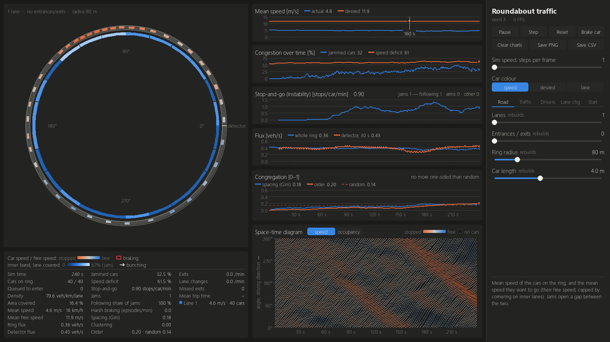
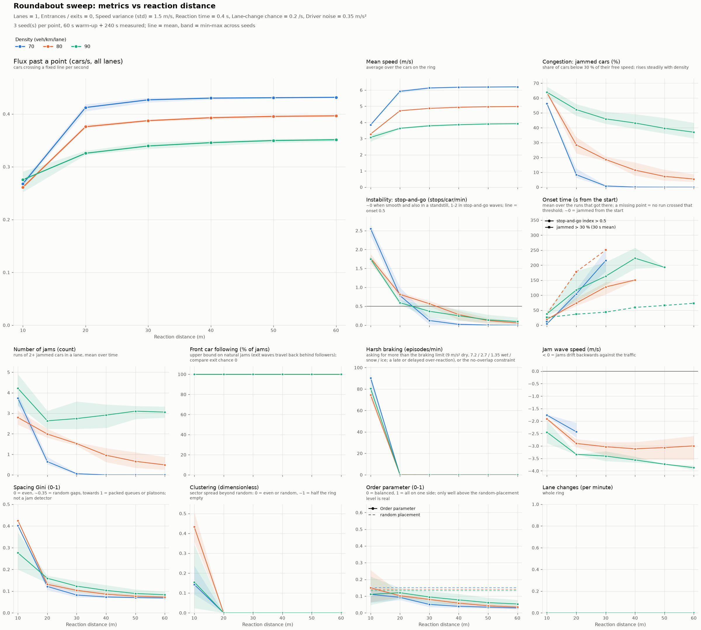

# Roundabout traffic model

An agent-based model of a multi-lane roundabout, built to study the **backups
that form among cars already circulating**: phantom jams and stop-and-go waves
that appear with no accident and no bottleneck. Every car is an independent
driver with its own desired speed, reaction time, attention span and
lane-change decisions. Small cars on a large ring let the roundabout hold
hundreds to thousands of them.

The interactive viewer is a single-lane closed ring. Most settings are
adjustable in the scrollable control list; lane count, car dimensions, and
lane-changing settings stay fixed and hidden. Batch experiments can still vary
any model parameter and write CSVs and figures.



## Quick start

```powershell
python -m venv .venv
.venv\Scripts\Activate.ps1            # macOS/Linux: source .venv/bin/activate
pip install -r requirements.txt

python -m roundabout_sim              # interactive viewer
python -m roundabout_sim.experiments run --baseline   # one headless run -> dashboard figure + CSVs
python -m roundabout_sim.experiments sweep --x density=10:150:10 --series n_lanes=1,2,3
python -m pytest -q                   # test suite (~1.5 min)
```

The viewer accepts flags for its adjustable settings and `--seed`; the seed
makes the randomized settings reproducible. Use
`python -m roundabout_sim --help` for viewer options. The experiments CLI
continues to expose all model parameters.

## Things to try

| Experiment | How | What you should see |
|---|---|---|
| **Phantom jams from nothing** | Entrances/exits = 0, Lanes = 1, Density 65, then slowly raise it to 85 | At 65-70 the flow is smooth. From about 75-80, stop-and-go waves appear spontaneously and drift backwards at about -3 m/s (orange stripes sloping down in the space-time diagram). This is a phase transition. |
| **Reaction distance** | Closed ring, 1 lane, Density 80; set Reaction distance to 10, 20, then 50 m | This is how far ahead drivers pay attention. At 10 m they notice the car in front too late and brake violently: over half the cars are jammed, with dozens of harsh-braking episodes per minute. At 20-25 m phantom jams form. From about 40 m drivers ease off early and the waves die down. |
| **Reaction time** | In a batch run, use `--set reaction_time=0.3`, then `--set reaction_time=1.0` | Slower reactions make waves form at much lower density (from about 50 instead of 75-80 on a closed ring), cut peak flux by about a third and cause a lot of harsh braking. |
| **Trigger a jam yourself** | Click any car (or press **B**) | The car brakes for 3 s. Near the threshold the disturbance grows into a wave that outlives it. |
| **Are the backups natural?** | `python -m roundabout_sim.experiments run --baseline` | Repeats the run with exit chance 0 (same seed) and reports how much of the jamming the entrances/exits cause. At the defaults (density 50) it is all of it: the same ring without exits does not jam until about 75. |
| **Speed variance** | Set Speed variance between 0 and 2 m/s | Bigger differences between drivers lower the flux at low density (slow drivers hold others up) and, in this model, slightly damp the waves. |
| **One lane, no entrances** | The viewer keeps one lane and a closed ring; compare with batch experiments using other road layouts | Lane changes and entries/exits are excluded from the viewer so the focus remains on traffic already on the ring. |
| **Initial spacing** | Set Initial spacing to uniform or clustered, once at Density 70 on a closed 1-lane ring and once at 50 | The average gap is set by Density. Just below the jam threshold an uneven start locks in jams that an even start barely forms (density 70: about 17 % against 5 % jammed). At 50 every start ends up the same within 1-2 min (watch Spacing (Gini) fall back). |
| **Many cars** | Ring radius 300, Car length 2, Lanes 5, Density 120 | About 1,150 cars, with dozens of jams forming and dissolving at once. |

## The viewer

The **ring view** draws every car to scale. Car colour shows speed relative to
the car's free speed: orange is stopped, grey is half speed and blue is free
flow. **C** switches to colouring by driver type or by lane.

- A thin inner band shows how much of each sector of the road is covered.
- An arrow points at the side where cars bunch up, shown only when they bunch
  more than chance would explain.
- The ring has no entrances or exits.
- A detector line counts cars passing a point.

The **controls** include sliders for Density and Driver noise. Other model
settings are randomized when the viewer starts and stay constant for the
session, including when restarted with **R**. Hover over any control, chart or
readout to see what it means.

Keys:

| Key | Action |
|---|---|
| Space | Pause / resume |
| R | Restart with a new seed |
| B | Brake a random car |
| + / - | Simulation speed |
| C | Car colours |
| S | Save a screenshot to `results/` |
| D | Save the chart data (last 10 min) as CSV, plus a settings file listing the settings, the live changes and the equivalent `experiments run` command |
| Esc | Quit |

The **live charts** share one time axis:

| Chart | What it shows |
|---|---|
| Mean speed | Actual average speed against the average speed drivers want. The gap is the cost of congestion. |
| Congestion over time | **The headline congestion measure.** Jammed cars (% below 30 % of their free speed; rises steadily with density) and speed deficit (% below free speed). |
| Stop-and-go (instability) | How often a moving car is forced to (nearly) stop, per car per minute. It is about 0 in smooth flow and also in a standstill, so read it with Congestion: it says how unstable the flow is, not how congested. Its header splits the current jams by what their front car is doing (hover over it). |
| Flux | Cars per second past a cross-section, summed over lanes: for the whole ring (from speeds) and at the detector line (cars actually counted). |
| Congregation | Spacing (Gini) and order parameter, with a dashed line for what randomly placed cars would give. Only an order parameter well above that line means the cars bunch on one side. |
| Space-time diagram | Angle on the ring (vertical) against time (horizontal), coloured by speed. Jams are stripes, and their slope is the wave speed. Toggle to occupancy to see where cars pile up. |

## Changeable variables

This is the full model parameter set used by batch experiments. In the
interactive viewer, controls are provided for the relevant settings, while
Lanes are fixed at 1, Entrances / exits at 0, and car dimensions and lane
changing are hidden. Settings are randomized once per launch and held across
resets. The viewer's Ring radius slider ranges from 20 to 60 m and its Speed
variance slider from 0 to 2 m/s. Reaction time, following gap, standstill gap,
and cornering limit are randomized but not exposed as controls; lane changing,
car dimensions, and entrance/exit-only settings are hidden as well. Max
acceleration is fixed at 1.2 m/s², comfortable braking at 2 m/s², and reaction
distance at 25 m.

**Road** (changing these rebuilds the roundabout)

| Parameter | Default | Range | Meaning |
|---|---|---|---|
| Lanes (`n_lanes`) | 3 | 1-5 | Number of concentric lanes on the ring. |
| Entrances / exits (`n_arms`) | 4 | 0-8 | Evenly spaced entry/exit pairs on the outer lane (0 = closed ring). |
| Ring radius (`radius`) | 80 m | Viewer: 20-60 m; batch: 20-300 m | Centreline radius of the innermost lane. |
| Car length (`car_length`) | 4 m | 1-8 m | Space each car takes up along the lane. |

**Traffic**

| Parameter | Default | Range | Meaning |
|---|---|---|---|
| Density (`density`) | 50 veh/km/lane | 1-300 | Cars on the ring per km of lane, capped at jam density. Raising it slots cars into gaps; lowering it removes cars. On a closed ring, waves appear from about 75-80. |
| Exit chance (`exit_prob`) | 0.1 | 0-1 | Chance that a car leaves at each exit it passes. Each leaver is replaced by a car at a random entrance, or slotted into the ring if that entrance already has a queue. |
| Entry gap (`entry_gap`) | 2 s | 1.5-6 s | Smallest time gap to circulating traffic that an entering car accepts. |
| Turn speed (`turn_speed`) | 6 m/s | 2-15 m/s | Speed at which cars enter and leave. |

**Drivers**

| Parameter | Default | Range | Meaning |
|---|---|---|---|
| Mean desired speed (`mean_speed`) | 12 m/s | 3-30 | Average speed drivers want to drive on a free road. |
| Speed variance (`speed_std`) | 1.5 m/s | Viewer: 0-2 m/s; batch: 0-6 m/s | Spread of desired speeds between drivers (floored at half the mean). |
| Reaction time (`reaction_time`) | 0.4 s | 0-2 s | Delay between perceiving the traffic and acting on it. |
| Reaction distance (`reaction_distance`) | 25 m | Viewer fixed at 25 m; batch: 10-100 m | How far ahead drivers pay attention. They react to every car within this distance (up to 5), so looking further ahead lets them ease off early and damps stop-and-go waves. Very short (10-15 m) and they notice the car in front too late and brake violently. |
| Following time gap (`time_headway`) | 1.2 s | 0.5-3 s | Desired time gap to the car in front. |
| Standstill gap (`min_gap`) | 2 m | 0.5-5 m | Bumper-to-bumper gap kept in a stopped queue. |
| Max acceleration (`max_accel`) | 1.2 m/s² | Viewer fixed at 1.2 m/s²; batch: 0.3-4 m/s² | How briskly drivers speed up. |
| Comfortable braking (`comfort_decel`) | 2 m/s² | Viewer fixed at 2 m/s²; batch: 0.5-5 m/s² | Braking drivers are happy to use. |
| Driver noise (`driver_noise`) | 0.35 m/s² | 0-1.5 m/s² | Random fluctuations in each driver's acceleration. More noise brings waves on earlier. |
| Cornering limit (`lateral_accel`) | 4 m/s² | 1-10 | Hidden in viewer; randomized each launch. Comfortable sideways acceleration; it makes tight inner lanes slower. |

**Lane changing (Lane chg tab) and start**

| Parameter | Default | Range | Meaning |
|---|---|---|---|
| Lane-change chance (`lane_change_rate`) | 0.2 /s | 0-1 | How often (per second) a driver considers changing lane. |
| Lane-change motive (`lane_change_motive`) | advantage | advantage / random | *advantage*: change only when it is faster (the MOBIL model); *random*: change into any safe gap. |
| Politeness (`politeness`) | 0.3 | 0-1 | How much drivers weigh the braking they force on others. |
| Initial spacing (`init_spacing`) | uniform | uniform / random / clustered | The average gap is set by Density. *uniform*: evenly spaced; *random*: random gaps; *clustered*: one packed queue across all lanes. Near the jam threshold an uneven start can lock in jams; elsewhere the effect fades within 1-2 min. |

Parameter ranges and defaults live in
[`roundabout_sim/config.py`](roundabout_sim/config.py), used by the viewer and
the experiments CLI.

## How congestion is measured

There is no single "congestion" number, so the model reports a few that answer
different questions.

**How congested is it?**

- **Jammed cars** (`jam_fraction`) is the headline measure. It is the share of
  cars crawling below 30 % of their free speed, in queues and in stop-and-go
  waves alike, and it rises steadily with density.
- **Speed deficit** (`speed_deficit`) is how far below free speed the cars
  drive in total.
- **Time to congestion** (`congestion_onset`, experiments only) is the first
  time the 30 s mean of jammed cars exceeds 30 %, counted from t = 0. A start
  that is already jammed scores about 0.

**How unstable is it?**

- **Stop-and-go index** (`stops_per_car_min`) counts stops per car per minute
  over the last 30 s. A *stop* is a car that had been moving (above 60 % of
  the speed it is aiming for) dropping below 30 % of it. Slowing down to turn
  off at an exit doesn't count.
  - In smooth flow, however dense, it is about 0.
  - In a standstill it is also about 0, because nobody is moving to be stopped.
  - In stop-and-go waves it is about 1-2.
- **Time to first stop-and-go** (`stop_go_onset`, experiments only) is the
  first time the index, counted over a full 30 s window, exceeds 0.5. That
  means a quarter of the cars were forced to stop within 30 s.

**What holds the jams up?**

- **Number of jams** (`n_jams`) counts runs of two or more jammed cars in a
  lane.
- Each jam is classified by what its front car is doing now:
  - *following*: just following the car ahead;
  - *merge*: a leaver moving out to its exit;
  - *exit*: slowing down to leave;
  - *entry*: just came in;
  - *other*: braked by you, or slotted in by the density control.
- The **following share** (`following_jam_share`) is only an **upper bound**
  on natural (phantom) jams. A wave set off at an exit keeps travelling
  backwards with ordinary followers at its front. With the defaults it is
  about 70-85 %, yet the same run with exit chance 0 has no jams at all.
- The honest test of what the entrances and exits cause is
  `experiments run --baseline`. Its `arm_jam_share` is
  1 − jammed(no exits) / jammed. Alternatively, sweep with
  `--series exit_prob=0,0.1`.

**Other dynamics**

- **Jam wave speed** (experiments) is estimated from the space-time diagram.
  Negative means the wave moves backwards against the traffic. The model gives
  about -2 to -4 m/s; real stop-and-go waves are about -4 to -5.5 m/s
  (-15 to -20 km/h).
- **Harsh braking** (`emergency_per_min`) counts episodes per minute. An
  episode is either the driver model asking for more than 9 m/s² (an
  over-reaction after a late or delayed response), or the no-overlap
  constraint stopping a car harder than that.
  - With the default drivers it is 0 on a ring without exits, and a few per
    minute from merging at the default 4 entrances/exits.
  - It grows sharply with shorter reaction distance, longer reaction time and
    higher density.

**Space and flow**

- **Flux** (`flux`, `detector_flux`): cars per second through a
  cross-section, both for the whole circle (Σ speed / lane length) and as
  counted at the detector line.
- **Area covered** (`occupancy`): the share of the road surface covered by
  cars.
- **Spacing Gini** (`spacing_gini`): the Gini coefficient of the road length
  each car has (gap ahead + car length).
  - 0 means the road is shared evenly.
  - About 0.35 means random gaps.
  - Values towards 1 mean packed queues or platoons.

  It is good for initial spacing and platoons, but it is not a jam detector.
- **Order parameter** (`order_param`, `order_angle`): |mean of e^(iθ)| over
  all cars.
  - 0 means the cars are balanced around the ring; 1 means they are all on one
    side.
  - `order_angle` gives the side where they bunch up.
  - `order_baseline` = √(π/4N) is what N randomly placed cars give, so only
    values well above it (the viewer uses 2×) mean real one-sidedness.
- **Clustering** (`clustering`): the spread of car counts over 6-24 sectors,
  after subtracting random scatter. 0 means even or random placement, and about
  1 means half the ring is empty. It is often 0 in dense flow.

## Batch experiments

```powershell
# one run: dashboard (space-time diagram, congestion over time, jam causes, ...) + CSVs
python -m roundabout_sim.experiments run --set n_lanes=1 --set n_arms=0 --set density=80 --duration 600

# how much of the jamming do the entrances/exits cause? (repeats the run with exit_prob = 0, same seed)
python -m roundabout_sim.experiments run --baseline --duration 300

# sweep: any parameter on x, optionally one line per value of another; seeds run in parallel
python -m roundabout_sim.experiments sweep --x reaction_distance=10:60:10 --series density=70,80,90 --set n_arms=0 --set n_lanes=1
```

| Command | Output | Contents |
|---|---|---|
| `run` | `PREFIX.png` | Dashboard |
| | `PREFIX_timeseries.csv` | One row per sample (default every 0.5 s) |
| | `PREFIX_summary.csv` | Settings plus metrics over the second half. With `--baseline` it also has `baseline_*` columns and `arm_jam_share`. |
| | `PREFIX_spacetime.npz` | Space-time and occupancy arrays |
| `sweep` | `PREFIX.csv` | One row per run: every setting and the metrics averaged over the measurement window |
| | `PREFIX.png` | Flux against x as the main chart, plus speed, jammed %, stop-and-go, onsets, jams, following share, harsh braking, wave speed, spacing Gini, clustering, order and lane changes. Each shows the mean across seeds with a min-max band. |

Settings columns are named like the parameters. A measurement that shares a
name gets a `measured_` prefix, for example `measured_density`. Runs are
deterministic for a given seed.



## How the model works

Cars drive anticlockwise on concentric circular lanes. A car's state is its
lane, its angle on the ring and its speed. Each 0.1 s step works as follows:

1. **Car following (IDM, multi-anticipation).** Each driver's acceleration
   comes from the Intelligent Driver Model, towards the cars ahead in its lane.
   - It reacts to every car within the *reaction distance* (up to 5), as in
     Treiber's Human Driver Model, so looking further ahead damps waves. A very
     short distance means late, violent braking.
   - Drivers act on what they perceived *reaction time* ago, and add correlated
     random noise.
   - A hard no-overlap constraint keeps cars from ever driving into each
     other.
2. **Exits.**
   - A car's route ends at an exit, chosen by giving it the *exit chance* at
     every exit it passes.
   - Leavers move out to the outer lane in time, slow to the turn speed and
     leave.
   - A leaver that cannot get out goes round again. So does a leaver held at a
     standstill by merging traffic for more than 5 s.
3. **Lane changes.**
   - Leavers merge cooperatively: they slot in behind the car beside them, and
     that car's follower eases off to let them in.
   - Other drivers consider a change *lane-change chance* times per second and
     make it if it is safe and, in "advantage" mode, faster (MOBIL).
4. **Entries.** Queued cars (at most 2 per entrance) merge into the outer lane
   when the gap to circulating traffic is at least the *entry gap*.

The engine ([`engine.py`](roundabout_sim/engine.py)) is vectorised with numpy.
It runs about 80 cars at over 100× real time and about 1,900 cars at about
55× real time, so the viewer stays smooth with thousands of cars.

**Known simplifications.**

- Entrances and exits always come in pairs (one arm = one entrance + one exit);
  their numbers cannot be set separately.
- Each leaver is replaced at a random entrance, so arrivals always match
  departures. Density is set as cars on the ring, a closed system, rather than
  as an arrival rate.
- Lane changes are instant in the model; the viewer animates them.
- Entrances and exits are points on the outer lane, without approach roads.
- All drivers share the same reaction time and IDM parameters; only desired
  speed varies between drivers.
- Jam causes describe what each jam's front car is doing now, not what started
  the jam (see above).

## Project layout

```
roundabout_sim/
  config.py       parameters: defaults, ranges, help text (drives sliders and CLIs)
  engine.py       RingSim - the vectorised multi-lane ring traffic engine
  metrics.py      flux, congestion (jammed cars, stop-and-go), jam causes, spacing / order; Recorder
  palette.py      shared colours for viewer and figures
  app.py          pygame viewer (python -m roundabout_sim)
  experiments.py  run / sweep CLI (python -m roundabout_sim.experiments)
  plots.py        matplotlib dashboard and sweep figures
tests/            pytest suite: engine invariants, metrics, regressions, viewer and CLI smoke tests
docs/             images used in this README
```
